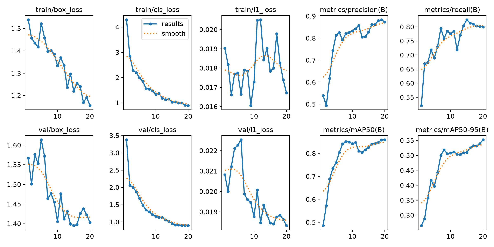
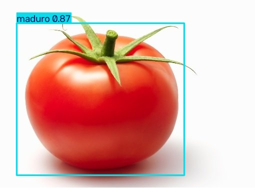
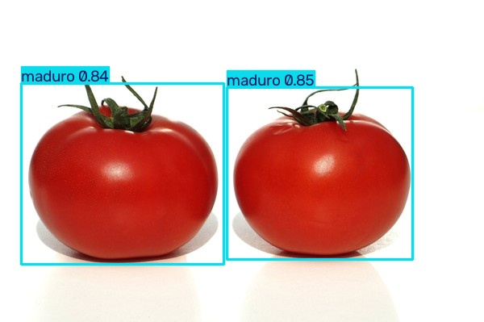
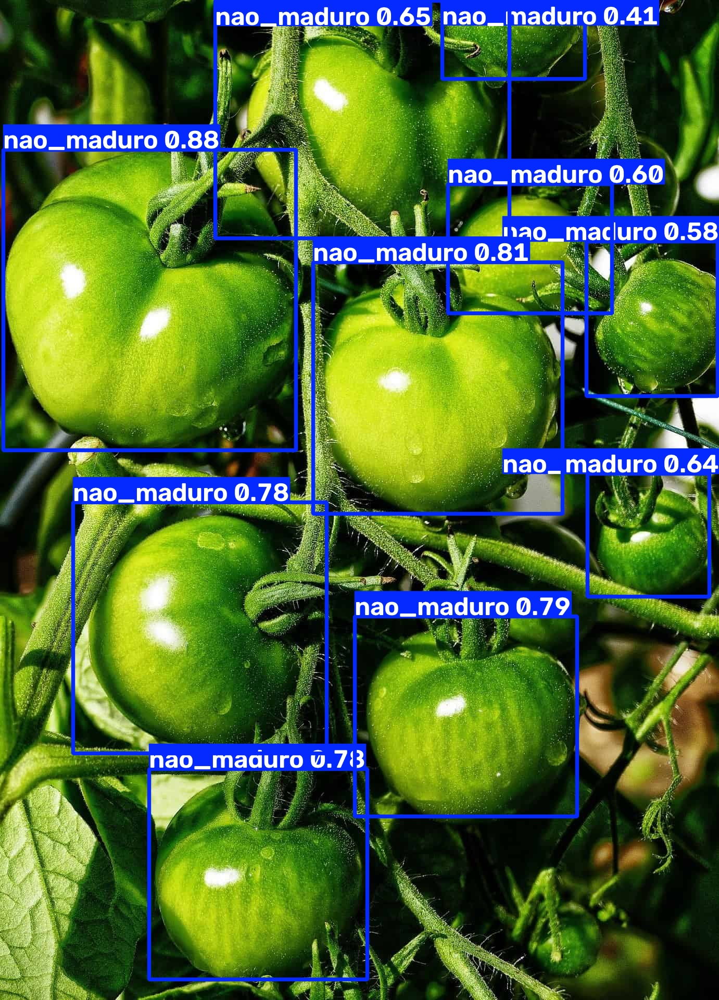
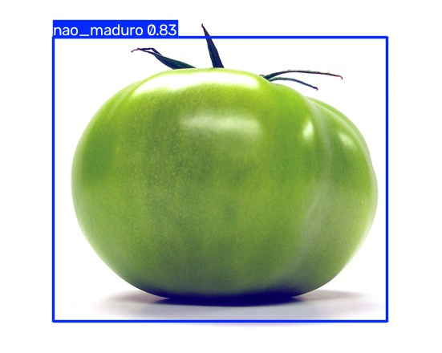
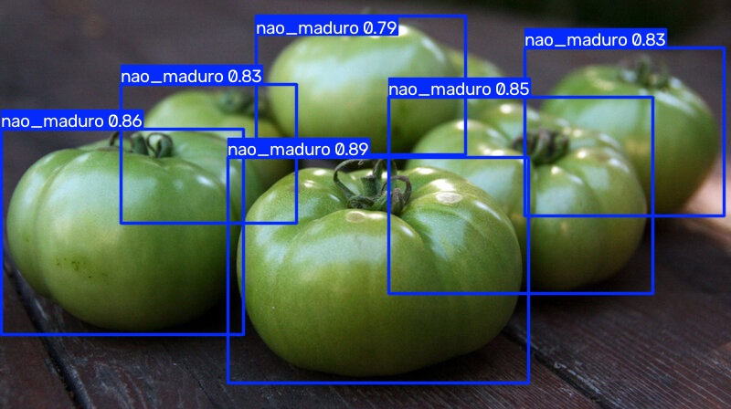

# Relatório técnico — Atividade prática final YOLO

> **Correção após auditoria:** foram encontradas fotos idênticas em divisões diferentes (ver ../docs/CONFERENCIA.md). As métricas abaixo registram a execução original com vazamento de dados e não comprovam generalização. Na final, todas as cinco imagens reservadas têm cópias no treino/validação e não atendem ao requisito de imagens inéditas. É necessário refazer a divisão, o treino e a avaliação.

**Nome:** Kauan Reis Bueno  
**Turma:** 8 Período  
**Data:** 17/11/2026

## 1. Problema e motivação

O projeto detecta tomates em dois estágios de maturação: não maduro e maduro. A tarefa foi escolhida como exemplo de visão computacional aplicada à agricultura; caixas delimitadoras informam também a posição dos frutos na imagem.

## 2. Dataset e classes

Dataset: **Ripe and Unripe Tomatoes Dataset**, de Suman Kunwar, Kaggle: https://www.kaggle.com/datasets/sumn2u/riped-and-unriped-tomato-dataset/versions/2. Foram pareadas 177 imagens JPEG e anotações de detecção YOLO; mapeamento: classe 0 `nao_maduro` (original `unriped`) e classe 1 `maduro` (original `riped`). Licença declarada: CC BY-SA 4.0. Uma caixa de altura zero foi removida apenas das cópias preparadas. Divisão: 137 treino, 35 validação e cinco imagens inéditas.

## 3. Modelo e treinamento

Foi utilizado YOLO26n com pesos pré-treinados, 20 épocas, imagem 640, lote 4 e CPU (`workers=0`). O melhor checkpoint está em `modelo/best.pt`.

## 4. Métricas e interpretação

- Precision: 0,874
- Recall: 0,800
- mAP50: 0,859

Precision é a proporção das detecções emitidas que estão corretas. Recall é a proporção dos objetos reais que foram encontrados. mAP50 resume a precisão média por classe considerando como correspondência uma sobreposição IoU de pelo menos 0,50 entre caixa prevista e caixa anotada. Valores de validação no melhor checkpoint: mAP50-95 0,552, em 35 imagens e 210 instâncias.

## 5. Imagens inéditas

A comparação entre as previsões e as anotações de referência foi feita nas cinco imagens reservadas por nome de arquivo. As previsões estão em `runs/detect/resultados/imagens_ineditas/` e as referências em `dataset/ready/unseen/labels_referencia/`. A auditoria posterior encontrou cópias idênticas dessas imagens em treino/validação; por isso, essa reserva não constitui uma avaliação em imagens inéditas.

| Imagem inédita | TP / FP / FN | Observação |
|---|---|---|
| riped_tomato_29.jpeg | 1 / 0 / 0 | Classe maduro localizada |
| riped_tomato_47.jpeg | 2 / 0 / 0 | Duas caixas corretas |
| unriped_tomato_33.jpeg | 9 / 1 / 1 | Um falso positivo e uma omissão |
| unriped_tomato_41.jpeg | 1 / 0 / 0 | Classe nao_maduro localizada |
| unriped_tomato_70.jpeg | 6 / 0 / 0 | Seis caixas corretas |

TP/FP/FN foram contados comparando classe e IoU ≥ 0,50 com as anotações reservadas. No total das cinco imagens (20 objetos anotados), houve 19 TP, 1 FP e 1 FN. As previsões ilustradas foram salvas em `runs/detect/resultados/imagens_ineditas/`; a tabela completa está em `evidencias/comparacao_ineditas.csv`.

### Imagens com as detecções

## 6. Dificuldades e melhorias

Uma anotação de origem tinha altura zero e foi removida somente das cópias preparadas. O conjunto é pequeno e tem variedade limitada; nas cinco imagens inéditas houve um falso positivo e uma omissão. Mais imagens diversas, revisão de rótulos e caixas e validação em diferentes cenários ajudariam a medir e aumentar a generalização. Cinco imagens são uma demonstração didática, não prova de robustez operacional.

## Respostas às seis questões

1. **Problema escolhido:** localizar e classificar tomates em dois estágios de maturação; o tema oferece aplicação agrícola e classes visuais relacionadas.
2. **Dados e classes:** 177 imagens anotadas, distribuídas em 137 treino, 35 validação e cinco inéditas. Fonte Kaggle indicada acima; classes `nao_maduro` e `maduro`; arquivos JPEG e rótulos de caixas YOLO.
3. **Modelo e épocas:** YOLO26n pré-treinado, 20 épocas, `imgsz=640`, `batch=4`, CPU (`workers=0`).
4. **Métricas:** Precision 0,874, Recall 0,800, mAP50 0,859 (validação; mAP50-95 0,552). Precision mede acerto entre as previsões, recall mede cobertura dos objetos reais, e mAP50 agrega a precisão por classe com IoU 0,50.
5. **Reconhecimento inédito:** quatro imagens tiveram todas as caixas correspondidas; em `unriped_tomato_33.jpeg` houve um falso positivo e uma omissão. No conjunto de cinco, 19 TP, 1 FP e 1 FN comparando classe e IoU ≥0,50.
6. **Dificuldades e melhorias:** uma caixa inválida (altura zero) foi removida nas cópias; o conjunto e a reserva inédita são pequenos. Mais exemplos diversos e rótulos revisados podem melhorar a generalização.

## Evidências e arquivos da entrega

Os arquivos que acompanham este relatório estão organizados na pasta da atividade:

- **Dados e configuração:** imagens e anotações em `dataset/ready/`, com o arquivo `data.yaml`. A origem e a licença do dataset estão descritas na seção 2.
- **Modelo treinado:** pesos salvos em `modelo/best.pt`.
- **Código e comandos:** scripts `prepare_dataset.py` e `compare_unseen.py`, além de `comandos.txt`.
- **Resultados do treinamento:** parâmetros e métricas por época em `evidencias/`; gráficos em `runs/detect/resultados/treino_final/`.
- **Detecções:** cinco imagens com as caixas previstas e arquivos com os escores em `runs/detect/resultados/imagens_ineditas/`.

As métricas e predições apresentadas correspondem aos artefatos salvos nessa execução.
