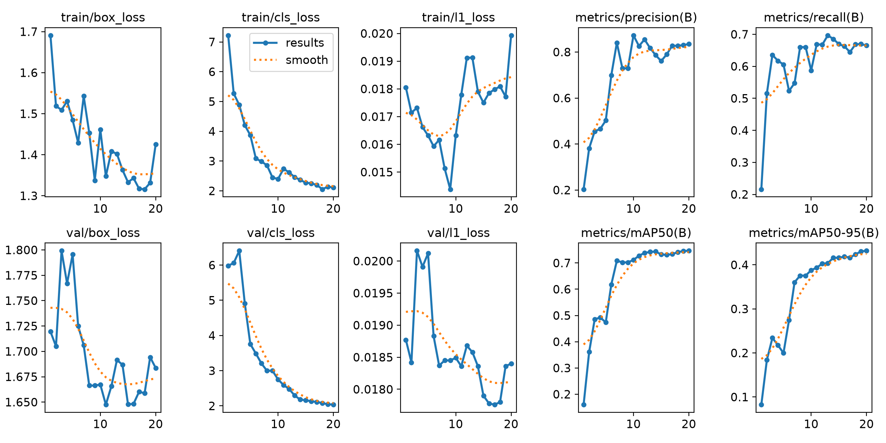
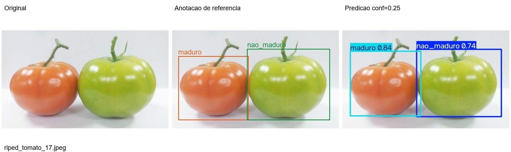
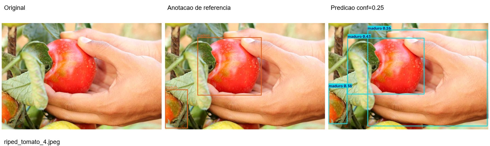
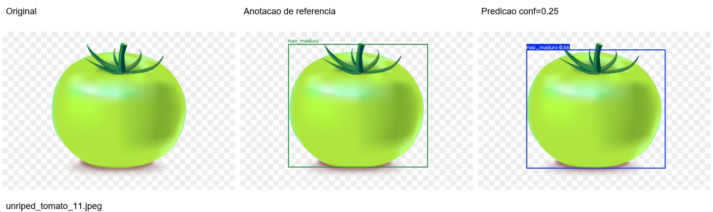
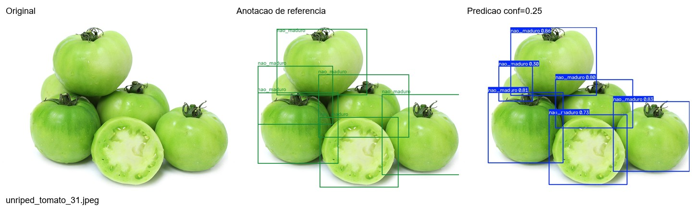
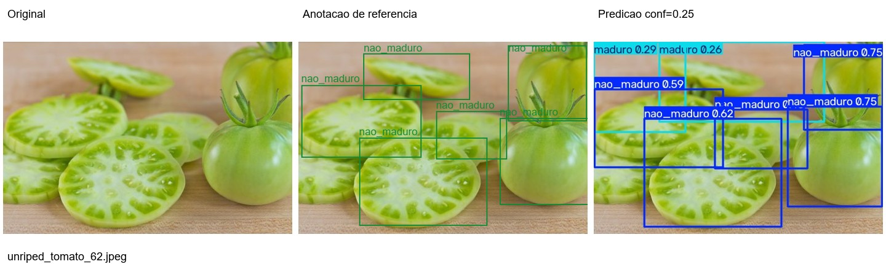

# Relatório técnico — Atividade prática final: detecção com YOLO

**Nome:** Kauan Reis Bueno  
**Turma:** 8 Período  
**Data:** 17/11/2026

## Projeto e preparação dos dados

O projeto localiza tomates e distingue dois estágios de maturação: `0: nao_maduro` (original `unriped`) e `1: maduro` (original `riped`). A localização é representada por caixas delimitadoras.

Fonte: **Ripe and Unripe Tomatoes Dataset**, de Suman Kunwar, [Kaggle](https://www.kaggle.com/datasets/sumn2u/riped-and-unriped-tomato-dataset/versions/2). Licença declarada: **CC BY-SA 4.0**. O conjunto original contém 177 arquivos de imagem; a finalidade é apoiar aplicações de visão computacional na agricultura.

A revisão identificou cópias idênticas e versões muito semelhantes de uma mesma fotografia. Antes da nova divisão, foram calculados SHA-256 e hash perceptual (pHash, 64 bits). Arquivos com mesmo SHA-256 ou distância de Hamming de pHash ≤ 8 foram agrupados. Foi mantida uma imagem por grupo, escolhendo o arquivo com mais caixas válidas e desempate pelo nome. A anotação usada é a do próprio arquivo selecionado; não foram combinadas caixas de imagens diferentes.

Foram encontrados 89 arquivos distintos por SHA-256. Após o agrupamento visual, restaram **78 imagens representativas**. A escolha de um subconjunto menor evita que cópias ou versões da mesma fotografia atravessem os grupos de treino e avaliação. Uma caixa de altura zero identificada na origem foi descartada durante a conferência das anotações. Os representantes selecionados contêm 459 caixas válidas no total.

A divisão usa ordem determinística e estratificação pela classe majoritária, preservando as duas classes em cada grupo. O mapa dos 177 arquivos para seus representantes e a divisão exata estão em `evidencias/preparacao_corrigida.json` e `evidencias/divisoes.csv`.

| Divisão | Imagens | Objetos anotados |
|---|---:|---:|
| train | 58 | 324 |
| val | 15 | 118 |
| ineditas | 5 | 17 |

A conferência após a preparação não encontrou duplicações exatas nem pares com distância pHash ≤ 8 entre divisões. Esse critério não garante ausência de toda semelhança possível entre cenas. O teste em fotografias de outras fontes continua sendo uma melhoria recomendada.

As 58 imagens de treino e 15 de validação somam **73 imagens anotadas**, acima do mínimo de 60. As **cinco imagens inéditas** foram reservadas antes do treinamento e não aparecem, nem por cópia ou pelo critério de similaridade aplicado, no treino ou na validação deste modelo.

### Estrutura e configuração

```text
dataset/ready/
├── images/train/
├── images/val/
├── labels/train/
├── labels/val/
├── unseen/images/
├── unseen/labels_referencia/
└── data.yaml
```

```yaml
path: dataset/ready
train: images/train
val: images/val
names:
  0: nao_maduro
  1: maduro
```

Exemplo de anotação correspondente a `riped_tomato_17.jpeg` (classe, centro X, centro Y, largura e altura normalizados):

```text
1 0.248198 0.590128 0.421386 0.652296
0 0.698540 0.554046 0.496948 0.726336
```

## Treinamento e avaliação

Modelo: **YOLO26n** com pesos pré-treinados de origem; os pesos antigos treinados com a divisão inadequada não foram reutilizados. Foram executadas **20 épocas**, `imgsz=640`, `batch=4`, `device=cpu`, `workers=0` e `seed=2026`. Ambiente: Windows 11, Python 3.12.10, Ultralytics 8.4.214 e PyTorch 2.15.0+cpu, em AMD Ryzen 5 5500U.

Os pesos do melhor checkpoint estão em `modelo/best.pt`. A seleção do checkpoint usou a validação; a divisão de teste/reserva não participou da atualização dos pesos nem da escolha do checkpoint.

**Validação:** Precision **0,786**, Recall **0,677**, mAP50 **0,731** e mAP50-95 **0,418**.

Precision mede a proporção de previsões corretas entre as detecções emitidas; Recall mede a fração dos objetos reais que o modelo encontrou. mAP50 é a média, entre classes, da área sob a curva de precisão e revocação com correspondência de caixas em IoU ≥ 0,50. mAP50-95 agrega vários limiares de IoU e exige localização mais rigorosa. Os valores do Ultralytics não são a mesma coisa que a contagem fixa de TP/FP/FN em `conf=0.25`.



## Resultados nas imagens reservadas

A comparação usa classe correta e IoU ≥ 0,50, com pareamento de uma previsão por objeto. Erros de classe aparecem como falso positivo e falso negativo; a coluna de erro de classe indica esse subconjunto, sem somá-lo novamente aos totais.

Nas cinco imagens inéditas, há **17 objetos anotados**. Em `conf=0.25`, o modelo retornou **15 TP, 4 FP e 2 FN**, com 0 erro(s) de classe identificado(s) no pareamento.

| Imagem | Objetos de referência | TP | FP | FN | Erros de classe |
|---|---:|---:|---:|---:|---:|
| riped_tomato_17.jpeg | 2 | 2 | 0 | 0 | 0 |
| riped_tomato_4.jpeg | 2 | 2 | 1 | 0 | 0 |
| unriped_tomato_11.jpeg | 1 | 1 | 0 | 0 | 0 |
| unriped_tomato_31.jpeg | 6 | 5 | 1 | 1 | 0 |
| unriped_tomato_62.jpeg | 6 | 5 | 2 | 1 | 0 |

Cada painel apresenta a imagem original, as caixas da anotação de referência e as previsões do modelo.

### riped_tomato_17.jpeg



### riped_tomato_4.jpeg



### unriped_tomato_11.jpeg



### unriped_tomato_31.jpeg



### unriped_tomato_62.jpeg



## Respostas às seis questões

1. **Problema escolhido:** localizar tomates e distinguir maduros e não maduros, como demonstração de visão computacional aplicada à agricultura.
2. **Imagens e classes:** dos 177 arquivos públicos originais, foram selecionadas 78 imagens após controle de duplicações. Foram usadas 58 para treino e 15 para validação, totalizando 73 imagens anotadas, além de cinco inéditas reservadas. Classes: `nao_maduro` e `maduro`; origem e licença indicadas no início.
3. **Modelo e épocas:** YOLO26n com pesos pré-treinados de origem, 20 épocas, resolução 640, lote 4 e CPU. O treinamento foi refeito após a correção dos dados.
4. **Métricas:** Precision **0,786**, Recall **0,677**, mAP50 **0,731** e mAP50-95 **0,418**. Precision mede acerto entre as detecções emitidas; Recall mede cobertura dos objetos anotados; mAP50 integra precisão e revocação por classe em IoU 0,50.
5. **Objetos nas imagens inéditas:** 17 objetos anotados, 15 correspondências corretas, 4 falsos positivos e 2 omissões em conf=0,25 e IoU ≥ 0,50. Os cinco painéis mostram os resultados e a tabela registra as falhas.
6. **Dificuldades e melhorias:** o dataset de origem tinha duplicações e uma caixa de altura zero; a preparação foi corrigida antes deste treino. A quantidade de cenas distintas e a reserva final são pequenas. Mais fotografias independentes e variadas, revisão de anotações e ajuste cuidadoso de resolução/épocas podem melhorar a cobertura e a localização.

## Conclusão e arquivos da entrega

A execução corrigida usa conjuntos separados pelos critérios de duplicação aplicados. As métricas anteriores, calculadas com vazamento de dados, foram substituídas pelos resultados apresentados neste relatório. O conjunto é pequeno e as métricas não garantem desempenho em qualquer ambiente; ainda são desejáveis exemplos de fontes e condições diferentes.

Os arquivos estão organizados na pasta da atividade:

- **Dados:** `dataset/ready/`, com imagens, anotações e `data.yaml`.
- **Modelo:** `modelo/best.pt`, obtido neste treinamento de 20 épocas.
- **Preparação e execução:** `prepare_dataset.py`, scripts compartilhados na pasta `scripts/` da raiz e `comandos.txt`.
- **Evidências:** `evidencias/preparacao_corrigida.json`, `metricas_corrigidas.json`, `resultados_treinamento.csv`, comparações CSV/JSON e os cinco painéis visuais.
- **Treinamento e detecções:** `runs/detect/resultados/`.

Os resultados foram gerados nas execuções registradas. As evidências incluem logs textuais, gráficos e imagens; não são capturas literais de tela do terminal.
