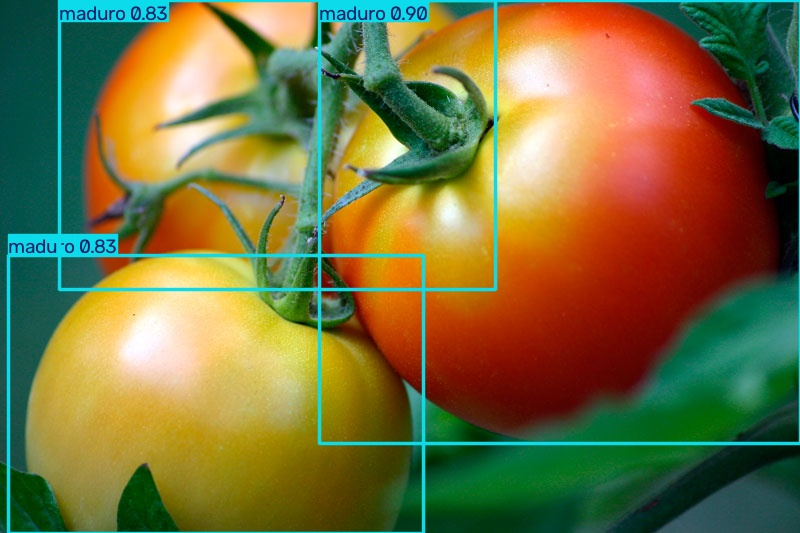
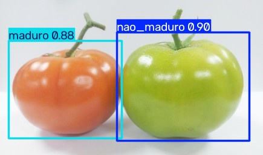
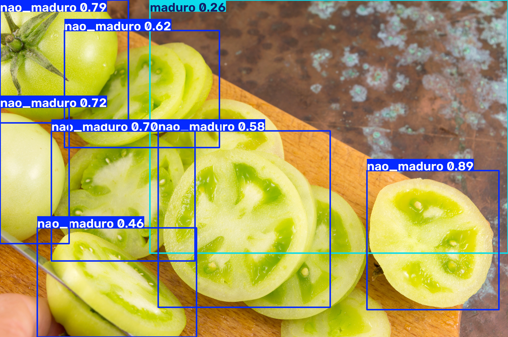
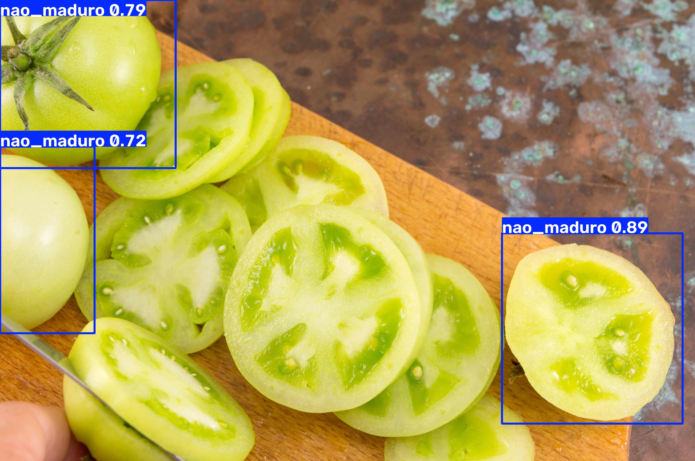
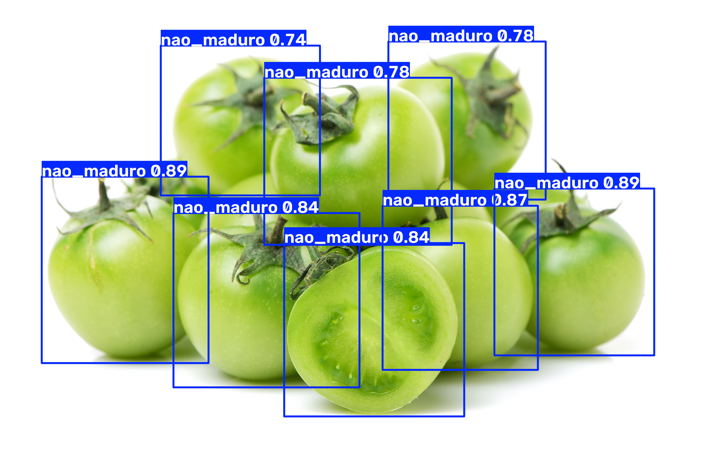
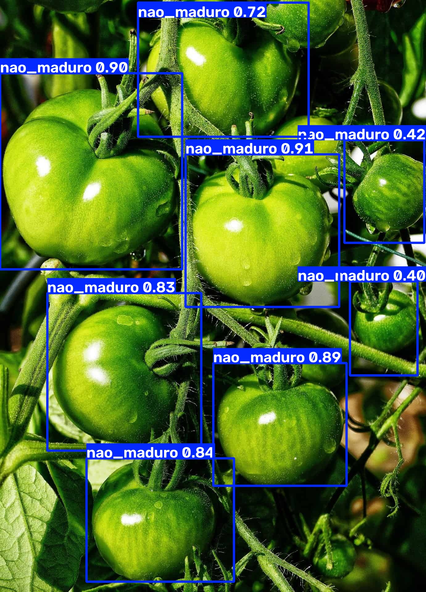
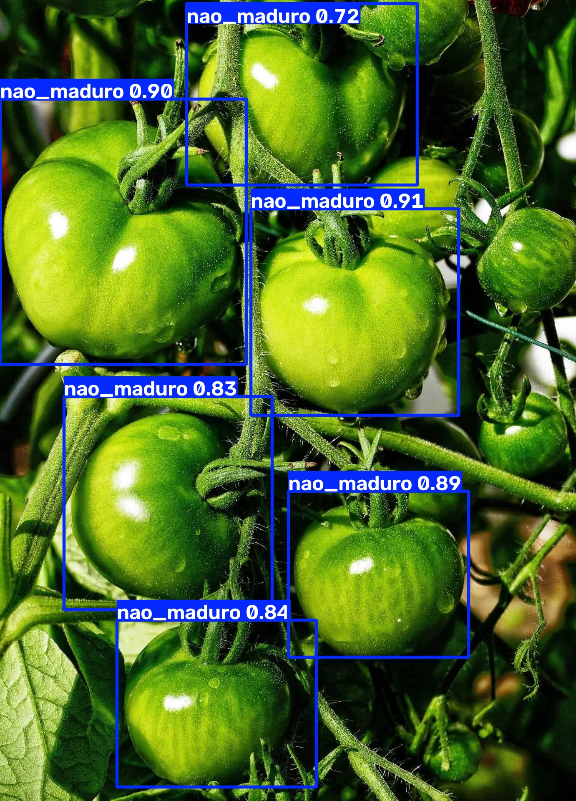
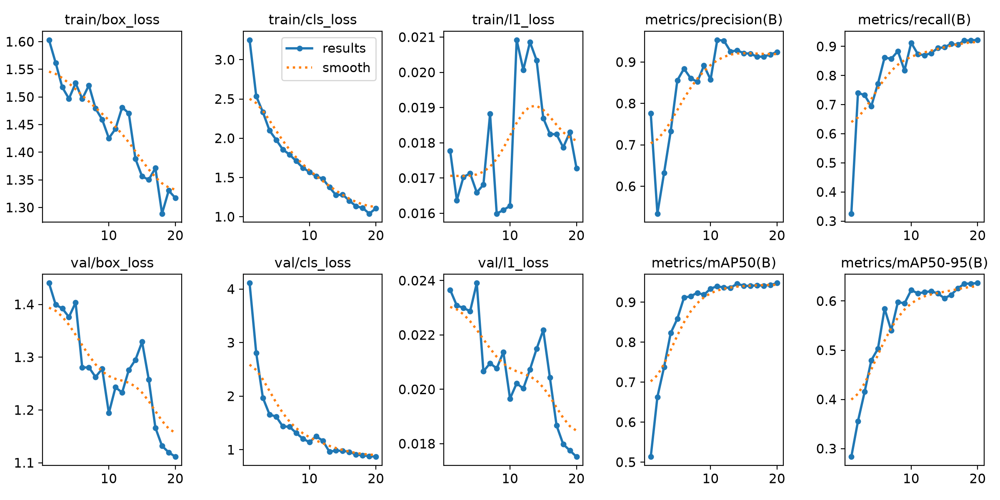

# Relatório técnico — Atividade prática II

> **Correção após auditoria:** foram encontradas fotos idênticas em divisões diferentes (ver ../docs/CONFERENCIA.md). As métricas abaixo registram a execução original com vazamento de dados e não comprovam generalização. Na final, todas as cinco imagens reservadas têm cópias no treino/validação e não atendem ao requisito de imagens inéditas. É necessário refazer a divisão, o treino e a avaliação.

**Nome:** Kauan Reis Bueno  
**Turma:** 8 Período  
**Data:** 17/11/2026

## Dataset e problema

Foi escolhido o **Ripe and Unripe Tomatoes Dataset**, publicado no Kaggle por Suman Kunwar. A descrição informa 177 imagens JPEG anotadas para detecção, duas classes (`0: unriped`, `1: riped`) e arquivos YOLO com `classe x_centro y_centro largura altura`. A finalidade é distinguir frutos em diferentes estágios de maturação, aplicação ligada à automação agrícola. Licença declarada: CC BY-SA 4.0. Fonte: https://www.kaggle.com/datasets/sumn2u/riped-and-unriped-tomato-dataset/versions/2.

## Respostas

### 1. Dataset escolhido

Dataset público do Kaggle sobre tomates maduros e não maduros; foram pareadas 177 imagens JPEG com rótulos YOLO de duas classes. A licença indicada na página é CC BY-SA 4.0. Foi identificado um rótulo degenerado (altura zero); essa caixa foi removida apenas na cópia preparada, sem alterar o original.

### 2. O que é bounding box e por que normalizar?

Bounding box é um retângulo que delimita a posição e o tamanho de um objeto na imagem. No formato YOLO, registram-se centro X, centro Y, largura e altura em relação às dimensões da imagem, entre 0 e 1. A normalização torna as coordenadas independentes da resolução em pixels e facilita usar tamanhos de imagem diferentes.

### 3. Para que serve `data.yaml`?

Ele informa ao treinamento onde estão as imagens de treino, validação e teste e qual nome corresponde a cada ID de classe. Se a ordem estiver errada, o modelo aprenderá ou reportará nomes trocados, mesmo que as caixas estejam geometricamente corretas.

### 4. Treinamento e inferência

No treinamento, imagens anotadas são usadas para ajustar os pesos da rede, reduzindo erros de localização e classificação. Na inferência, os pesos já ajustados são aplicados a imagens de entrada para prever caixas, classes e escores, sem atualizar o modelo.

### 5. Boa precisão com objetos perdidos

Sim. Precisão alta significa que poucas detecções emitidas são falsas; recall baixo significa que muitos objetos reais ficaram sem detecção. Por exemplo, um modelo pode emitir uma caixa apenas quando tem alta confiança e ainda omitir vários objetos.

### 6. Por que poucos acertos não provam robustez?

Alguns exemplos não cobrem variações de iluminação, escala, fundo, ângulo, oclusão e aparência. O desempenho em imagens específicas não garante generalização; por isso são necessários dados representativos e avaliação em imagens separadas do treino.

### 7. Efeito de `conf=0.25` versus `conf=0.70`

O limiar 0,70 elimina previsões com escore inferior a ele, então reduz o número de caixas. Nos 19 testes, o total passou de 100 caixas (conf=0,25) para 82 (conf=0,70). Comparando as caixas com os rótulos de referência em IoU ≥ 0,50, os acertos caíram de 92 para 79, falsos positivos de 8 para 3 e falsos negativos subiram de 9 para 22. Portanto, 13 detecções corretas desapareceram e 5 falsos positivos foram removidos. Os resultados das cinco imagens da tabela também mostram essa troca.

## Configuração e resultados experimentais

- Quantidade pareada total: 177 imagens; 868 caixas válidas após remoção de uma caixa de altura zero.
- Treino / validação / teste: 123 / 35 / 19 imagens (seed=42; 70/20/10 aproximado).
- Modelo e épocas: YOLO26n pré-treinado, 20 épocas, `imgsz=416`, `batch=4`, CPU (`workers=0`)
- Métricas de validação do treino: Precision 0,923; Recall 0,922; mAP50 0,948; mAP50-95 0,637.
- Métricas no teste separado: Precision 0,916; Recall 0,919; mAP50 0,944; mAP50-95 0,639 (19 imagens, 101 objetos anotados).
- `best.pt`: `modelo/best.pt`.

| Imagem de teste | Objetos anotados | TP / FP / FN em 0,25 | TP / FP / FN em 0,70 |
|---|---:|---:|---:|
| riped_tomato_15 | 3 | 3 / 0 / 0 | 3 / 0 / 0 |
| riped_tomato_17 | 2 | 2 / 0 / 0 | 2 / 0 / 0 |
| unriped_tomato_2 | 6 | 5 / 3 / 1 | 2 / 1 / 4 |
| unriped_tomato_39 | 8 | 8 / 0 / 0 | 8 / 0 / 0 |
| unriped_tomato_61 | 11 | 8 / 0 / 3 | 6 / 0 / 5 |

TP/FP/FN foram calculados com correspondência de classe e IoU ≥ 0,50. As predições anotadas estão em `runs/detect/resultados/conf025/` e `conf070/`.

### Exemplos visuais (original + predição em 0,25 e 0,70)

#### riped_tomato_15

#### riped_tomato_17

#### unriped_tomato_2

#### unriped_tomato_39

#### unriped_tomato_61

## Organização e evidências

`dataset/yolo/` contém as divisões e `data.yaml`; `runs/detect/resultados/` contém os artefatos do Ultralytics; `evidencias/` contém parâmetros e métricas do treino. As pastas `conf025/` e `conf070/` têm as cinco imagens selecionadas e as demais predições anotadas. A autoria, a origem e a licença do dataset estão registradas na seção Dataset e problema.

## Conclusão

O modelo atingiu métricas altas neste teste de 19 imagens, mas o tamanho e a origem única do dataset limitam a generalização. O limiar 0,70 reduziu falsos positivos, mas perdeu mais objetos corretos. A caixa degenerada encontrada mostra a necessidade de revisar anotações; mais imagens diversas e uma revisão das caixas ajudariam a avaliar e melhorar a robustez.
