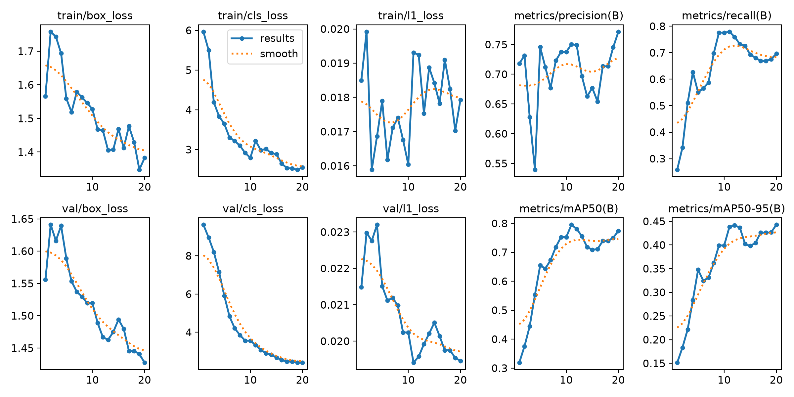
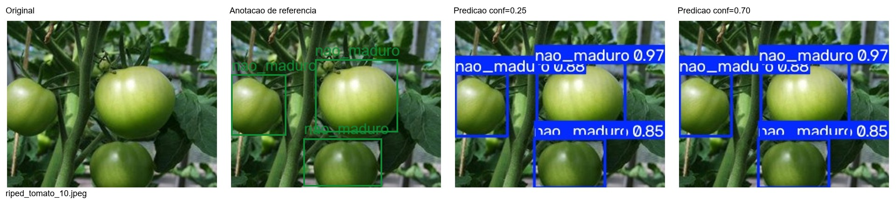
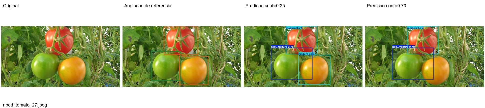
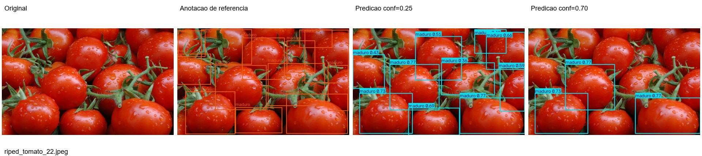
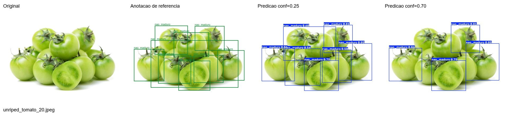
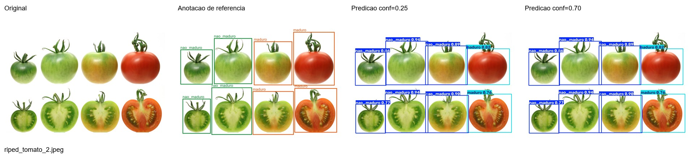

# Relatório técnico — Atividade prática II: YOLO + Kaggle

**Nome:** Kauan Reis Bueno  
**Turma:** 8 Período  
**Data:** 17/11/2026

## Projeto e preparação dos dados

O projeto localiza tomates e distingue dois estágios de maturação: `0: nao_maduro` (original `unriped`) e `1: maduro` (original `riped`). A localização é representada por caixas delimitadoras.

Fonte: **Ripe and Unripe Tomatoes Dataset**, de Suman Kunwar, [Kaggle](https://www.kaggle.com/datasets/sumn2u/riped-and-unriped-tomato-dataset/versions/2). Licença declarada: **CC BY-SA 4.0**. O conjunto original contém 177 arquivos de imagem; a finalidade é apoiar aplicações de visão computacional na agricultura.

A revisão identificou cópias idênticas e versões muito semelhantes de uma mesma fotografia. Antes da nova divisão, foram calculados SHA-256 e hash perceptual (pHash, 64 bits). Arquivos com mesmo SHA-256 ou distância de Hamming de pHash ≤ 8 foram agrupados. Foi mantida uma imagem por grupo, escolhendo o arquivo com mais caixas válidas e desempate pelo nome. A anotação usada é a do próprio arquivo selecionado; não foram combinadas caixas de imagens diferentes.

Foram encontrados 89 arquivos distintos por SHA-256. Após o agrupamento visual, restaram **78 imagens representativas**. A escolha de um subconjunto menor evita que cópias ou versões da mesma fotografia atravessem os grupos de treino e avaliação. Uma caixa de altura zero identificada na origem foi descartada durante a conferência das anotações. Os representantes selecionados contêm 459 caixas válidas no total.

A divisão usa ordem determinística e estratificação pela classe majoritária, preservando as duas classes em cada grupo. O mapa dos 177 arquivos para seus representantes e a divisão exata estão em `evidencias/preparacao_corrigida.json` e `evidencias/divisoes.csv`.

| Divisão | Imagens | Objetos anotados |
|---|---:|---:|
| train | 55 | 346 |
| val | 15 | 73 |
| test | 8 | 40 |

A conferência após a preparação não encontrou duplicações exatas nem pares com distância pHash ≤ 8 entre divisões. Esse critério não garante ausência de toda semelhança possível entre cenas. O teste em fotografias de outras fontes continua sendo uma melhoria recomendada.

### Estrutura e configuração

```text
dataset/yolo/
├── images/train/
├── images/val/
├── images/test/
├── labels/train/
├── labels/val/
├── labels/test/
└── data.yaml
```

```yaml
path: dataset/yolo
train: images/train
val: images/val
test: images/test
names:
  0: nao_maduro
  1: maduro
```

Exemplo de anotação correspondente a `riped_tomato_10.jpeg` (classe, centro X, centro Y, largura e altura normalizados):

```text
0 0.597938 0.451890 0.395127 0.435801
0 0.131959 0.506717 0.256420 0.365511
0 0.532334 0.848797 0.371884 0.283037
```

## Treinamento e avaliação

Modelo: **YOLO26n** com pesos pré-treinados de origem; os pesos antigos treinados com a divisão inadequada não foram reutilizados. Foram executadas **20 épocas**, `imgsz=416`, `batch=4`, `device=cpu`, `workers=0` e `seed=42`. Ambiente: Windows 11, Python 3.12.10, Ultralytics 8.4.214 e PyTorch 2.15.0+cpu, em AMD Ryzen 5 5500U.

Os pesos do melhor checkpoint estão em `modelo/best.pt`. A seleção do checkpoint usou a validação; a divisão de teste/reserva não participou da atualização dos pesos nem da escolha do checkpoint.

**Validação:** Precision **0,792**, Recall **0,696**, mAP50 **0,776** e mAP50-95 **0,444**.

**Teste separado:** Precision **0,831**, Recall **0,855**, mAP50 **0,839** e mAP50-95 **0,510**. O teste contém 8 imagens e 40 objetos anotados.

Precision mede a proporção de previsões corretas entre as detecções emitidas; Recall mede a fração dos objetos reais que o modelo encontrou. mAP50 é a média, entre classes, da área sob a curva de precisão e revocação com correspondência de caixas em IoU ≥ 0,50. mAP50-95 agrega vários limiares de IoU e exige localização mais rigorosa. Os valores do Ultralytics não são a mesma coisa que a contagem fixa de TP/FP/FN em `conf=0.25`.



## Resultados nas imagens reservadas

A comparação usa classe correta e IoU ≥ 0,50, com pareamento de uma previsão por objeto. Erros de classe aparecem como falso positivo e falso negativo; a coluna de erro de classe indica esse subconjunto, sem somá-lo novamente aos totais.

| Configuração | Caixas previstas | TP | FP | FN | Erros de classe |
|---|---:|---:|---:|---:|---:|
| conf=0,25 | 36 | 31 | 5 | 9 | 2 |
| conf=0,70 | 22 | 19 | 3 | 21 | 2 |

Ao elevar o limiar de 0,25 para 0,70, as caixas previstas passaram de 36 para 22. Os verdadeiros positivos passaram de 31 para 19 e os falsos positivos de 5 para 3; os falsos negativos passaram de 9 para 21. Isso mostra a perda de detecções corretas e a redução de parte das detecções incorretas.

### Cinco exemplos com referência e previsões

| Imagem | TP / FP / FN em 0,25 | TP / FP / FN em 0,70 | Erros de classe em 0,25 / 0,70 |
|---|---|---|---|
| riped_tomato_10.jpeg | 3 / 0 / 0 | 3 / 0 / 0 | 0 / 0 |
| riped_tomato_27.jpeg | 3 / 0 / 0 | 2 / 0 / 1 | 0 / 0 |
| riped_tomato_22.jpeg | 10 / 0 / 3 | 3 / 0 / 10 | 0 / 0 |
| unriped_tomato_20.jpeg | 6 / 1 / 3 | 4 / 0 / 5 | 0 / 0 |
| riped_tomato_2.jpeg | 6 / 2 / 2 | 6 / 2 / 2 | 2 / 2 |

Cada painel apresenta a imagem original, as caixas da anotação de referência e as previsões do modelo.

### riped_tomato_10.jpeg



### riped_tomato_27.jpeg



### riped_tomato_22.jpeg



### unriped_tomato_20.jpeg



### riped_tomato_2.jpeg



## Respostas às sete questões

1. **Dataset escolhido:** conjunto público de tomates de Suman Kunwar no Kaggle, com 177 arquivos originais e anotações de detecção YOLO. Foram utilizadas 78 imagens representativas após remover cópias exatas e versões próximas. Classes: não maduro e maduro. A finalidade original é apoiar reconhecimento de maturação em aplicações agrícolas; licença CC BY-SA 4.0 e fonte indicadas na seção inicial.
2. **Bounding box e normalização:** uma caixa delimita a região ocupada pelo objeto. No YOLO, centro e dimensões são divididos pela largura/altura da imagem, gerando coordenadas de 0 a 1 independentes da resolução em pixels.
3. **Função de data.yaml:** define os caminhos de treino, validação e teste e o nome de cada ID de classe. Uma ordem incorreta associa caixas a nomes errados e pode produzir classes trocadas.
4. **Treinamento e inferência:** treinamento ajusta os pesos da rede usando exemplos anotados. Inferência aplica os pesos salvos a novas entradas, sem ajustá-los. O treino parte dos pesos pré-treinados e gera um checkpoint específico para as duas classes.
5. **Boa precisão com objetos omitidos:** sim. Precision alta indica poucos falsos positivos, mas Recall baixo indica muitos objetos reais sem detecção. Um limiar alto pode produzir exatamente essa combinação.
6. **Generalização:** acertar poucos exemplos não garante funcionamento em iluminação, fundo, escala e ângulo diferentes. Separar cenas semelhantes e usar dados independentes é necessário para avaliar essa capacidade. Mesmo corrigido, o teste de oito imagens é pequeno.
7. **Experimento de confiança:** Ao elevar o limiar de 0,25 para 0,70, as caixas previstas passaram de 36 para 22. Os verdadeiros positivos passaram de 31 para 19 e os falsos positivos de 5 para 3; os falsos negativos passaram de 9 para 21. Isso mostra a perda de detecções corretas e a redução de parte das detecções incorretas. As tabelas, painéis e arquivos CSV registram as evidências.

## Conclusão e arquivos da entrega

A execução corrigida usa conjuntos separados pelos critérios de duplicação aplicados. As métricas anteriores, calculadas com vazamento de dados, foram substituídas pelos resultados apresentados neste relatório. O conjunto é pequeno e as métricas não garantem desempenho em qualquer ambiente; ainda são desejáveis exemplos de fontes e condições diferentes.

Os arquivos estão organizados na pasta da atividade:

- **Dados:** `dataset/yolo/`, com imagens, anotações e `data.yaml`.
- **Modelo:** `modelo/best.pt`, obtido neste treinamento de 20 épocas.
- **Preparação e execução:** `prepare_dataset.py`, scripts compartilhados na pasta `scripts/` da raiz e `comandos.txt`.
- **Evidências:** `evidencias/preparacao_corrigida.json`, `metricas_corrigidas.json`, `resultados_treinamento.csv`, comparações CSV/JSON e os cinco painéis visuais.
- **Treinamento e detecções:** `runs/detect/resultados/`.

Os resultados foram gerados nas execuções registradas. As evidências incluem logs textuais, gráficos e imagens; não são capturas literais de tela do terminal.
