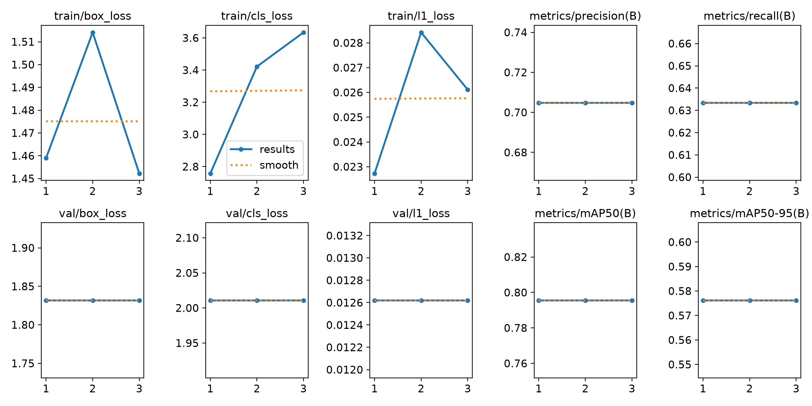
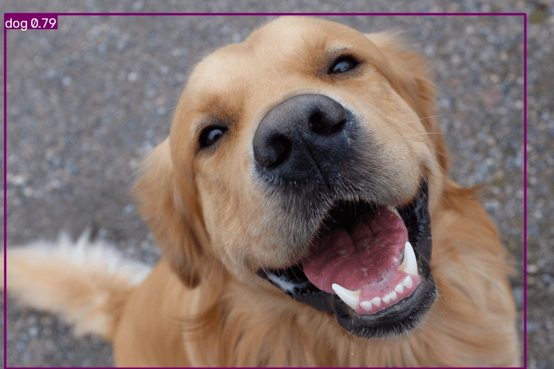
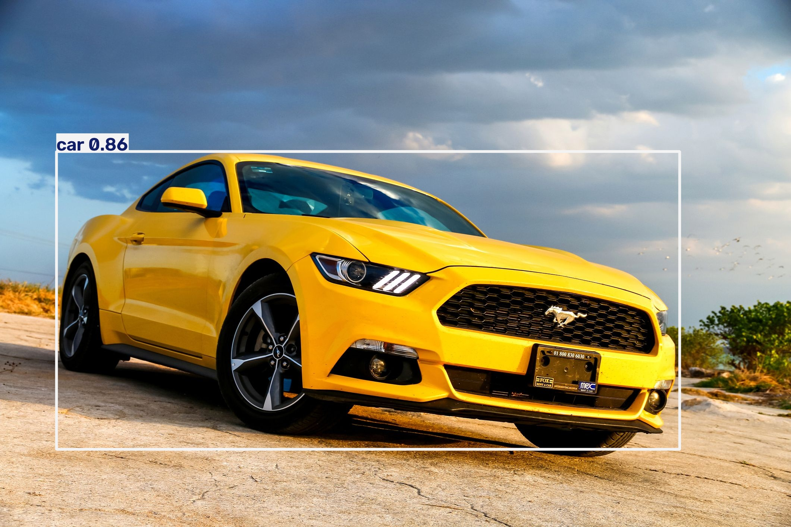
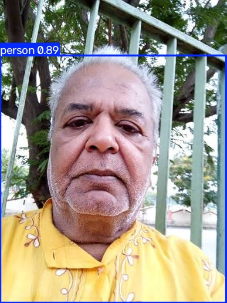
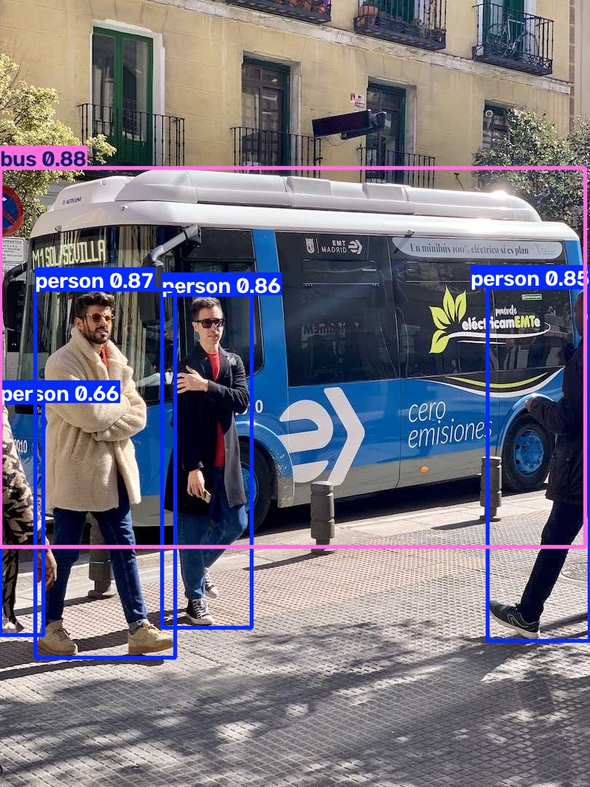
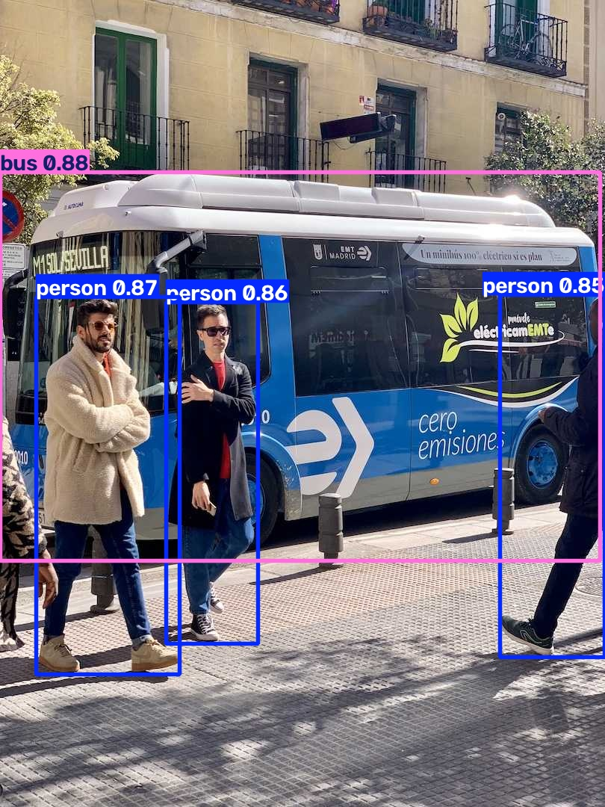

# Relatório — Atividade prática: YOLO no Windows

**Nome:** Kauan Reis Bueno  
**Turma:** 8 Período  
**Data:** 17/11/2026

## Objetivo e procedimento

O objetivo foi configurar Python e um ambiente virtual no Windows, instalar Ultralytics, executar detecção com o modelo pré-treinado YOLO26n, comparar dois limiares de confiança e realizar um treino experimental no COCO8. Os comandos estão em `README.md`.

## Respostas às perguntas

### 1. O que é Python e por que é usado em IA?

Python é uma linguagem de programação de alto nível, com sintaxe acessível e um ecossistema amplo de bibliotecas para dados, aprendizado de máquina e visão computacional. Isso permite combinar preparação dos dados, treinamento e inferência com ferramentas como PyTorch e Ultralytics.

### 2. Para que serve um ambiente virtual?

Um ambiente virtual mantém as dependências deste projeto separadas das de outros projetos. Sem esse isolamento, versões incompatíveis de uma biblioteca podem substituir umas às outras e quebrar programas diferentes; também fica mais difícil reproduzir a configuração usada.

### 3. Qual a diferença entre CPU e GPU em redes neurais?

CPU é um processador de uso geral, adequado para executar o YOLO em tarefas pequenas, mas tende a levar mais tempo. GPU executa muitas operações numéricas em paralelo e costuma acelerar treinamento e inferência de redes neurais, desde que haja hardware e suporte compatíveis.

### 4. Classificar a imagem inteira é diferente de localizar o ônibus?

Classificação atribui uma ou mais categorias à imagem como um todo. Detecção também prevê uma caixa delimitadora para cada objeto e associa a ela uma classe e um escore, indicando onde o ônibus aparece.

### 5. O que muda ao aumentar `conf` de 0,25 para 0,70?

O limiar mais alto descarta previsões cujo escore é inferior a 0,70. Em geral, aparecem menos caixas; algumas previsões fracas incorretas podem desaparecer, mas objetos reais também podem deixar de ser detectados. Nesta execução, a foto de pessoa manteve uma detecção nos dois limiares; na imagem pública do ônibus, o total de pessoas detectadas caiu de quatro para três.

### 6. O treino experimental necessariamente melhora o modelo?

Não. O COCO8 tem apenas oito imagens e serve para conferir o funcionamento do pipeline, não para produzir um detector robusto. Poucos exemplos podem não representar a variedade do mundo real; o ajuste pode memorizar particularidades do conjunto e piorar a generalização. `best.pt` é o checkpoint escolhido pelo critério de validação do treino, o que não garante que ele supere os pesos iniciais em toda imagem.

## Resultados observados

- Versão do Python: 3.12.10
- Verificação Ultralytics: 8.4.214, PyTorch 2.15.0+cpu, Windows 11, CPU AMD Ryzen 5 5500U, 12 CPUs, 5,85 GB de RAM; sem GPU/CUDA.
- Modelo/pesos iniciais: YOLO26n (`yolo26n.pt`)
- Dataset experimental: COCO8 (4 imagens de treino e 4 de validação, conforme o enunciado)
- Treino: 3 épocas, `imgsz=320`, `batch=2`, CPU
- Caminho de `best.pt`: `modelo/best.pt`.
- Métricas COCO8 após 3 épocas: Precision 0,705; Recall 0,633; mAP50 0,796; mAP50-95 0,576 (4 imagens de validação e 17 instâncias).
- Primeira predição automática: `bus.jpg` teve 4 pessoas e 1 ônibus; `zidane.jpg`, 2 pessoas e 1 gravata.
- Imagem pública `bus.jpg`, modelo pré-treinado: `conf=0.25` detectou 4 pessoas e 1 ônibus; `conf=0.70` detectou 3 pessoas e 1 ônibus. Uma detecção de pessoa ficou abaixo do limiar alto.
- Imagem pública `bus.jpg`, checkpoint após treino: 4 pessoas e 1 ônibus. A contagem coincide com o modelo pré-treinado em 0,25; isso não demonstra melhora. As imagens com as caixas previstas estão incluídas na seção Evidências.
- Fotos próprias processadas com `conf=0.25`: `cachorro.png` → 1 cachorro (confiança 0,795); `carro.jpeg` → 1 carro (0,863); `pessoa.jpg` → 1 pessoa (0,889).
- Comparação na mesma foto (`pessoa.jpg`): `conf=0.25` e `conf=0.70` retornaram 1 pessoa em ambos os casos. A predição manteve confiança de aproximadamente 0,889, acima dos dois limiares.
- Comparação antes/depois do treino COCO8 em `pessoa.jpg`: os dois modelos retornaram 1 pessoa. Essa contagem não demonstra melhora; COCO8 tem só quatro exemplos de treino e quatro de validação e não é um conjunto personalizado de pessoas.
- Análise crítica: as três classes escolhidas foram localizadas nas imagens fornecidas. O limiar alto não removeu a detecção da foto de pessoa porque seu escore estava acima de 0,70. Iluminação, resolução, oclusão e ângulo podem alterar as previsões; confiança não é probabilidade calibrada. Os resultados visuais apresentados na seção Evidências permitem observar a posição das caixas e as classes previstas.

## Evidências

Parâmetros e métricas do treino: `evidencias/treino_coco8_args.yaml` e `evidencias/treino_coco8_results.csv`. Detecções das três fotos e arquivos com caixas/escores em `runs/detect/resultados/proprias_025/` e `proprias_com_scores/`; comparações em `pessoa_025/`, `pessoa_070/` e `pessoa_pos_treino/`. Pesos em `modelo/best.pt`. Os registros incluídos consistem em métricas, parâmetros e imagens geradas; não foram incluídas capturas de tela do terminal.

## Limitações

O ambiente, o treino COCO8 e as inferências nas imagens públicas e próprias foram executados. As saídas e métricas estão salvas. Este relatório apresenta as imagens detectadas e as métricas salvas. As capturas de tela do terminal solicitadas no enunciado não integram as evidências disponíveis.
