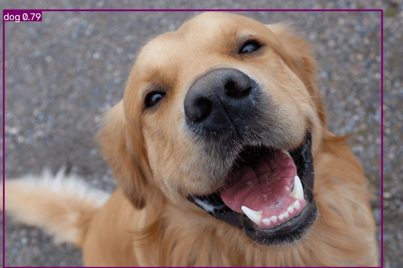
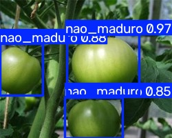
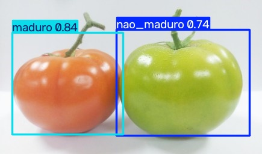

# Detecção de objetos com YOLO

**Trabalho de Inteligência Artificial · Kauan Reis Bueno · 8 Período · 17/11/2026**

Três atividades práticas que documentam a configuração do YOLO no Windows, o treinamento com um dataset do Kaggle e o desenvolvimento de um detector de tomates maduros e não maduros. O repositório reúne relatórios, códigos, pesos treinados, dados anotados e resultados das execuções.

## Relatórios

| Atividade | Relatório em PDF | Leitura no GitHub | Projeto |
|---|---|---|---|
| **01 · YOLO no Windows** | [Abrir PDF](relatorios/01_YOLO_Windows.pdf) | [Texto e figuras](Atividade_Pratica_YOLO_Windows/relatorio.md) | [Acessar atividade](Atividade_Pratica_YOLO_Windows/) |
| **02 · YOLO + Kaggle** | [Abrir PDF](relatorios/02_YOLO_Kaggle.pdf) | [Texto e figuras](Atividade_Pratica_II_YOLO_Kaggle/relatorio.md) | [Acessar atividade](Atividade_Pratica_II_YOLO_Kaggle/) |
| **03 · Projeto final** | [Abrir PDF](relatorios/03_Projeto_Final_YOLO.pdf) | [Texto e figuras](Atividade_Pratica_Final_YOLO/relatorio.md) | [Acessar atividade](Atividade_Pratica_Final_YOLO/) |

Os PDFs estão reunidos em **[relatorios/](relatorios/)**. A versão em Markdown permite consultar respostas e imagens diretamente pelo navegador, sem instalar o ambiente Python.

> **Separação dos dados verificada:** as duplicações identificadas na origem foram tratadas antes dos novos treinamentos. As atividades 2 e final usam 78 imagens representativas, com conjuntos separados por SHA-256 e pHash. Os resultados abaixo pertencem às execuções corrigidas. [Consultar a verificação](docs/CONFERENCIA.md).

## Atividades desenvolvidas

| Etapa | Objetivo | Materiais disponíveis |
|---|---|---|
| **01** | Preparar o ambiente e executar um detector pré-treinado | Detecções de cachorro, carro e pessoa; comparação de confiança; treino COCO8 de 3 épocas |
| **02** | Adaptar o detector às classes de um dataset anotado | Partições de treino, validação e teste; novo treino de 20 épocas; comparação entre `conf=0.25` e `conf=0.70` |
| **03** | Desenvolver e avaliar um detector específico | Treino de 20 épocas; pesos salvos; métricas e análise de cinco imagens reservadas |

### Exemplos das execuções

| Atividade 1 — objetos cotidianos | Atividade 2 — tomates | Projeto final — tomates |
|---|---|---|
|  |  |  |

## Resultados registrados

| Atividade | Modelo | Épocas | Conjunto avaliado | Precision | Recall | mAP50 | mAP50–95 |
|---|---|---:|---|---:|---:|---:|---:|
| 01 | YOLO26n | 3 | Validação COCO8 · 4 imagens | 0,705 | 0,633 | 0,796 | 0,576 |
| 02 | YOLO26n | 20 | Partição de teste · 8 imagens | 0,831 | 0,855 | 0,839 | 0,510 |
| 03 | YOLO26n | 20 | Validação · 15 imagens | 0,786 | 0,677 | 0,731 | 0,418 |

As métricas provêm de conjuntos diferentes. A atividade 2 usa o teste separado e a final usa a validação. Nas cinco imagens inéditas da final, foram anotados 17 objetos: 15 correspondências corretas, 4 falsos positivos e 2 omissões em conf=0,25, considerando classe correta e IoU ≥ 0,50. A conferência não encontrou cópias exatas nem pares semelhantes pelo critério aplicado entre essas imagens e o treino/validação. A amostra continua pequena, e não garante desempenho em qualquer cenário.

### Dados utilizados após a revisão

| Atividade | Treino | Validação | Teste ou inéditas |
|---|---:|---:|---:|
| 02 | 55 | 15 | 8 de teste |
| 03 | 58 | 15 | 5 inéditas |

Dos 177 arquivos da origem, 89 têm conteúdo distinto por SHA-256. O agrupamento de versões próximas por pHash resultou em 78 representantes. Na final, treino e validação somam 73 imagens anotadas, atendendo ao mínimo de 60 do enunciado.

## Organização do repositório

```text
Trabalho-YOLO/
├── README.md
├── relatorios/                          # Acesso central aos três PDFs
├── Atividade_Pratica_YOLO_Windows/       # Atividade 01
├── Atividade_Pratica_II_YOLO_Kaggle/      # Atividade 02
├── Atividade_Pratica_Final_YOLO/         # Atividade 03
├── docs/                                # Auditoria, fontes e estado da entrega
├── scripts/                             # Conferência e geração dos relatórios
├── executar.py                          # Inferência, avaliação e treinamento
├── requirements.txt
└── requirements-ambiente.txt
```

Cada atividade inclui o enunciado, o relatório, os pesos em `modelo/`, os dados utilizados e as saídas em `runs/detect/`. Parâmetros, métricas por época e comparações estão em `evidencias/`.

## Executar o projeto

Ambiente utilizado: **Windows 11, Python 3.12.10 e CPU AMD Ryzen 5 5500U**, com Ultralytics 8.4.214 e PyTorch 2.15.0. Os dados preparados e os pesos estão incluídos. Não é necessário autenticar no Kaggle para utilizar esta cópia.

No PowerShell:

```powershell
git clone https://github.com/kauanbuenodev/Trabalho-YOLO.git
cd Trabalho-YOLO
python -m venv .venv
.\.venv\Scripts\python.exe -m pip install -r requirements.txt
```

### Inferência com os modelos salvos

```powershell
.\.venv\Scripts\python.exe executar.py 1 inferir
.\.venv\Scripts\python.exe executar.py 2 inferir
.\.venv\Scripts\python.exe executar.py final inferir
```

As novas saídas ficam em `novas_execucoes/`. Os resultados históricos incluídos nos relatórios permanecem disponíveis em cada atividade.

### Avaliação e comparação

```powershell
.\.venv\Scripts\python.exe executar.py 1 avaliar
.\.venv\Scripts\python.exe executar.py 2 avaliar
.\.venv\Scripts\python.exe executar.py final avaliar
python executar.py 2 comparar
python executar.py final comparar
```

`avaliar` executa a avaliação dos checkpoints nos conjuntos incluídos. `comparar` recalcula as contagens a partir das predições e anotações salvas. Esses comandos reproduzem a execução corrigida sobre os dados já preparados, com controle de duplicações aplicado antes dos novos treinamentos.

Para repetir o treinamento, use `treinar` no lugar de `inferir`. Cada execução começa com os pesos pré-treinados incluídos e salva um novo experimento. No computador utilizado, o tempo de treinamento depende da quantidade de imagens e dos recursos disponíveis.

## Documentação e evidências

- [Guia da documentação](docs/README.md).
- [Conferência dos arquivos e duplicações](docs/CONFERENCIA.md).
- [Origem dos dados, licenças e alterações](docs/FONTES_E_DADOS.md).
- [Estado da entrega e correções necessárias](docs/ESTADO_DA_ENTREGA.md).
- [Inventário dos arquivos e hashes SHA-256](docs/INVENTARIO.csv).

Os relatórios incluem figuras e registros produzidos nas execuções. As capturas literais de tela do terminal solicitadas nos enunciados ainda não estão incluídas. Os históricos de comandos e `args.yaml` preservam caminhos do computador original; use `executar.py` para reproduzir o projeto em outra máquina.
